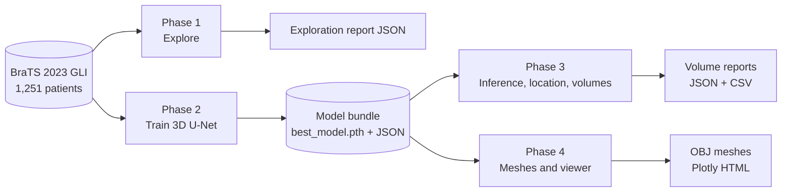
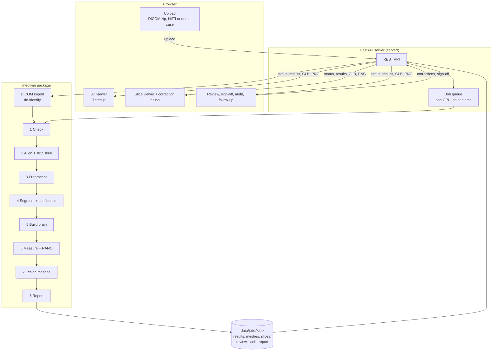

# MedTwin AI: Brain MRI to 3D Digital Twin — Project Report

**Status:** decision-support prototype, 13 October 2026  
**Scope:** brain MRI segmentation, tumour volumetry, clinician review and follow-up, and a web app with an interactive, colour-coded 3D brain

> **AI decision support for qualified clinicians.** Measurements must be verified on the source
> images by a radiologist. Not yet validated or approved for clinical decisions.

MedTwin takes a four-sequence brain MRI, straight from the scanner (DICOM) or as NIfTI files. It
aligns the sequences, removes the skull, finds glioma with a 3D U-Net, and measures each tumour
region in cm³ and by RANO diameters. The web page shows a realistic 3D brain in the patient's own
shape with the colour-coded tumour inside. A radiologist can correct the outline, sign it off and
follow the patient across scans. The model reaches a **test Dice of 0.78** on 188 held-out
patients. A prepared case runs in **about 20–35 seconds** on a laptop GPU (NVIDIA MX550); a raw
hospital study with skull stripping takes about 5 minutes.

- How to run it: [Quick start: run MedTwin from Command Prompt](#quick-start-run-medtwin-from-command-prompt)
- How to use the web app: [USER_MANUAL.md](USER_MANUAL.md)
- Developer notes, API and code layout: [medtwin_app/README.md](medtwin_app/README.md)

---

## Quick start: run MedTwin from Command Prompt

Open **Command Prompt**: press **Win + R**, type `cmd`, press **Enter**. Every command below was
tested in cmd on this computer.

### Step 1: go to the app folder

```bat
cd /d C:\Users\admin\Desktop\Med_Twin\Med_Twin\medtwin_app
```

### Step 2: start the server (choose one)

**A. For doctors on the hospital network** (HTTPS, port 8443). The first command creates or renews
the HTTPS certificate and prints the addresses doctors should open; the second starts the server.

```bat
.venv\Scripts\python scripts\network_setup.py
```

```bat
.venv\Scripts\python -m uvicorn server.app:app --host 0.0.0.0 --port 8443 --ssl-keyfile certs\medtwin.key --ssl-certfile certs\medtwin.crt
```

**B. On this computer only** (HTTP, port 8000):

```bat
.venv\Scripts\python -m uvicorn server.app:app --host 127.0.0.1 --port 8000
```

Wait about 20 seconds until the window shows `Uvicorn running on …`. Keep the window open while
MedTwin is in use.

### Step 3: open MedTwin

| Mode | On this computer | From other computers |
| --- | --- | --- |
| A. Network | `https://127.0.0.1:8443` | `https://<this computer's IPv4 address>:8443` (shown by step 2A, or run `ipconfig`) |
| B. This computer | `http://127.0.0.1:8000` | Not reachable |

In network mode the browser warns once about MedTwin's own certificate: click **Advanced**, then
**Continue**.

**Very first start:** on this computer, the page shows **First-time setup**. Create the
administrator account, then add doctors under **Users** (see [USER_MANUAL.md](USER_MANUAL.md),
section 3).

**First network start only:** allow the port in Windows Firewall. Open an **Administrator** Command
Prompt (Start → type `cmd` → right-click → Run as administrator) and run:

```bat
netsh advfirewall firewall add rule name="MedTwin" dir=in action=allow protocol=TCP localport=8443 profile=domain,private
```

### Step 4: stop the server

Click the Command Prompt window and press **Ctrl + C**. Cases and accounts stay saved; doctors sign
in again after the next start.

### Shortcuts

Double-click instead of typing: **`start_network.bat`** does step 2A, **`start.bat`** does step 2B
(both in the `medtwin_app` folder).

### Common problems

| Message or symptom | Cause | Fix |
| --- | --- | --- |
| `ModuleNotFoundError: No module named 'skimage'` (or `trimesh`, `HD_BET`) | Started with `python` instead of `.venv\Scripts\python` | Always use `.venv\Scripts\python` as shown |
| `error while attempting to bind on address … only one usage of each socket address` | MedTwin is already running on that port | Use the running copy, or stop it with Ctrl + C in its window |
| `The system cannot find the path specified` | Not in the `medtwin_app` folder | Run step 1 again |
| `.venv\Scripts\python` not found | The environment was never created | Run `start.bat` once; it creates `.venv` and installs the packages |
| Cannot sign in / forgot password | Wrong username, or forgotten password | **Forgot password?** on the sign-in screen; or on this computer `.venv\Scripts\python scripts\reset_password.py --list` (shows usernames) and `... reset_password.py <username>` (temporary password) |
| Other computers cannot connect | Firewall rule missing, or not on the same network | Add the firewall rule; check the address with `ipconfig` |
| Changes to the code do not show | Server still runs the old version | Stop with Ctrl + C and start again |

### More commands (from the `medtwin_app` folder)

Analyse one case without the website (results in `data\jobs\cli-<case name>`):

```bat
.venv\Scripts\python scripts\run_case.py ..\Dataset\ASNR-MICCAI-BraTS2023-GLI-Challenge-TrainingData\BraTS-GLI-00449-000 --ground-truth
```

Reset a forgotten password on this computer (lists usernames, then prints a temporary password):

```bat
.venv\Scripts\python scripts\reset_password.py --list
```

```bat
.venv\Scripts\python scripts\reset_password.py admin
```

Start over with new logins when nobody can sign in (accounts are archived, not destroyed; cases stay):

```bat
.venv\Scripts\python scripts\reset_password.py --reset-all
```

Run the automated tests (62 tests, about 5 minutes; they use their own temporary data, never your real accounts or cases):

```bat
.venv\Scripts\python -m pytest tests -q
```

Optional: activate the environment once, then type plain `python` in that window:

```bat
.venv\Scripts\activate.bat
```

```bat
python -m uvicorn server.app:app --host 127.0.0.1 --port 8000
```

---

## Contents

1. [Summary](#1-summary)
2. [Project structure](#2-project-structure)
3. [Dataset](#3-dataset)
4. [Research pipeline (notebooks)](#4-research-pipeline-notebooks)
5. [Model and results](#5-model-and-results)
6. [Web application](#6-web-application)
7. [Realistic 3D brain](#7-realistic-3d-brain)
8. [Clinical decision-support features](#8-clinical-decision-support-features)
9. [Verification](#9-verification)
10. [Issues found and their status](#10-issues-found-and-their-status)
11. [Limitations, risks and compliance](#11-limitations-risks-and-compliance)
12. [Roadmap](#12-roadmap)
13. [Technology and licences](#13-technology-and-licences)

---

## 1. Summary

| Item | Result |
| --- | --- |
| Disease covered | Adult glioma (BraTS 2023 GLI) |
| Regions measured | Enhancing tumour, necrotic core, edema |
| Model | MONAI 3D U-Net, 1.19 M parameters, 4 input sequences |
| Test set | 186 subject-independent scans (188 bundle entries, 2 repeat sessions removed) |
| Whole tumour Dice | **0.911** mean, 0.941 median (IoU 0.848) |
| Enhancing tumour Dice | **0.818** mean, 0.901 median (IoU 0.738) |
| Necrotic core Dice | **0.723** mean, 0.863 median (IoU 0.638) |
| Edema Dice | **0.810** mean, 0.885 median (IoU 0.712) |
| Tumour core Dice | **0.837** mean, 0.944 median (IoU 0.778) |
| Example case BraTS-GLI-00449-000 | Whole-lesion Dice 0.97; region Dice 0.87 / 0.83 / 0.93 (enhancing / necrotic / edema) |
| Processing time | About 20–35 s per prepared case on an MX550 GPU; about 5 min for a raw DICOM study needing skull stripping (CPU) |
| Inputs | DICOM study zip (series auto-detected, identifiers not stored), NIfTI files, or demo cases |
| Preparation | Automatic co-registration of the four sequences and HD-BET skull stripping |
| Clinical tools | Confidence overlay, RANO diameters, brush correction, sign-off, audit trail, follow-up timeline with RANO-based categories |
| Multi-doctor use | Doctor accounts with roles (administrator, radiologist, clinician), sign-offs tied to the signed-in doctor, HTTPS on the hospital network, conflict protection when two doctors edit one case |
| Web app | Upload → progress → realistic 3D brain + slices + findings + review + printable report + STL downloads |
| 3D brain | FreeSurfer fsaverage cortex warped to each patient (gyri and sulci) or the exact outline from the scan |
| Tests | 62 automated tests pass, including a regression test on a real patient, account/permission tests and password-recovery tests |

**Main fix delivered:** the notebooks reported tumour side and position inverted (left↔right,
front↔back, up↔down). The web app computes location in millimetres relative to the brain centre,
which was checked against the raw scan.

---

## 2. Project structure

```
Med_Twin/
├── 01_Brain_MRI_CT_Data_Exploration.ipynb        Phase 1: inspect the data
├── 02_Glioma_Segmentation_Training_Pipeline.ipynb Phase 2: train the 3D U-Net
├── 03_Tumor_Localization_and_Volume_Measurement-2.ipynb  Phase 3: inference, location, volumes
├── 03_Tumor_Localization_and_Volume_Measurement.ipynb    older copy of Phase 3
├── 04_3D_Tumor_Reconstruction_and_Viewer.ipynb    Phase 4: meshes and Plotly viewer
├── Dataset/                                       BraTS 2023 GLI training data (13 GB)
├── outputs/
│   ├── checkpoints/best_model.pth                 trained weights (4.6 MB)
│   ├── model_bundle/model_bundle.json             architecture, labels, preprocessing, patient split
│   ├── phase3_reports/                            volumes per patient and for the 188 test patients
│   ├── phase4_meshes/                             OBJ meshes and HTML viewer for one patient
│   ├── training_curves.png
│   └── persistent_cache/                          18 GB MONAI cache from an earlier experiment
├── medtwin_app/                                   the web application (new)
├── README.md                                      this report
└── USER_MANUAL.md                                 how to use the web app
```

The notebooks were not modified. The web app reads the trained model from `outputs/`.

---

## 3. Dataset

| Property | Value |
| --- | --- |
| Source | ASNR-MICCAI BraTS 2023 Adult Glioma (GLI) training data |
| Patients | 1,251, all complete |
| Files per patient | 5 NIfTI files: T1 native (`t1n`), T1 contrast (`t1c`), T2 (`t2w`), T2-FLAIR (`t2f`), segmentation (`seg`) |
| Volume size | 240 × 240 × 155 voxels, 1 mm isotropic, skull-stripped, co-registered |
| Stored orientation | LPS (re-oriented to RAS for processing) |

| Label | Meaning | Colour in the app |
| --- | --- | --- |
| 0 | Background | — |
| 1 | Necrotic tumour core | Dark red `#7a0b16` |
| 2 | Peritumoral edema | Yellow `#ffd23f` |
| 3 | Enhancing tumour | Crimson `#e0234e` |

Composite regions used for reporting: whole tumour = 1 + 2 + 3, tumour core = 1 + 3.

---

## 4. Research pipeline (notebooks)



### Phase 1: Data exploration

- Scanned 6,255 NIfTI files (1,251 segmentation masks), no DICOM.
- Loaded a sample volume and checked shape, data type, voxel spacing and orientation (LPS → RAS).
- Plotted intensity histograms and axial, coronal and sagittal slices, and overlaid the mask.
- Counted label voxels and estimated a first volume (57.3 cm³ for BraTS-GLI-00000-000).
- Ran structural checks (3D, no NaN or infinite values, valid spacing, mask matches image) and saved a JSON report.

### Phase 2: Segmentation training

| Setting | Value |
| --- | --- |
| Split (patient level, seed 42) | 875 train / 188 validation / 188 test |
| Preprocessing | Load → channel first → RAS → 1 mm → z-score (non-zero voxels) → stack 4 sequences → crop to brain → pad to multiple of 8 |
| Network | MONAI 3D U-Net, channels 16-32-64-128, strides 2-2-2, 2 residual units, batch norm |
| Loss | Dice + cross-entropy |
| Optimiser | Adam, learning rate 1e-4, weight decay 1e-5, cosine annealing |
| Training | 50 epochs, batch size 1, about 47 min per epoch on an RTX 5050 Laptop GPU (about 40 h) |

### Phase 3: Inference, localisation and volumes

- Rebuilds the model and preprocessing from the bundle; sliding-window inference with 96³ windows, 50% overlap.
- Per region: bounding box, centroid, volume in mm³ and cm³, plus composite regions.
- Ran on all 188 test patients and saved a summary CSV. Median whole-tumour volume is 95.5 cm³
  (range 0.2–262.3); median edema 57.3, enhancing 18.2 and necrotic 6.4 cm³.

### Phase 4: 3D reconstruction and viewer

- Marching cubes per region with light smoothing; meshes in real millimetres.
- Mesh volume agrees with voxel volume within 3.4%.
- Side-by-side prediction vs ground truth, saved as OBJ files and a 30.7 MB Plotly HTML viewer.
- The brain shell was the smoothed scan mask, so it looked like a blob without folds.

---

## 5. Model and results

### Validation Dice during training

| Epoch | 1 | 5 | 10 | 20 | 31 | 44 (best) | 50 |
| --- | --- | --- | --- | --- | --- | --- | --- |
| Validation Dice | 0.537 | 0.716 | 0.747 | 0.794 | 0.800 | **0.801** | 0.798 |

Validation Dice levelled off at about 0.80 from epoch 31, so more epochs alone will not improve
the model; a stronger architecture (for example nnU-Net) or more data would.

### Test set — subject-independent (186 unique subjects)

Re-evaluated with [`scripts/evaluate_test_set.py`](medtwin_app/scripts/evaluate_test_set.py). The 188 bundle entries contain 2 repeat-session scans from the same physical subject; those were deduplicated first so each person appears exactly once.

| Region | Dice mean | Dice median | Dice std | IoU mean |
| --- | --- | --- | --- | --- |
| Whole tumour (1+2+3) | **0.911** | 0.941 | 0.102 | 0.848 |
| Enhancing tumour | **0.818** | 0.901 | 0.234 | 0.738 |
| Necrotic core | **0.723** | 0.863 | 0.303 | 0.638 |
| Edema | **0.810** | 0.885 | 0.180 | 0.712 |
| Tumour core (1+3) | **0.837** | 0.944 | 0.260 | 0.778 |

Median is a more robust summary than mean here because a small number of very difficult cases (e.g. BraTS-GLI-00732-000 with whole-tumour Dice 0.058, BraTS-GLI-01364-000 with 0.241) pull the mean down. Full per-patient results: [`outputs/phase3_reports/eval_186subjects.csv`](outputs/phase3_reports/eval_186subjects.csv).

### Example patient BraTS-GLI-00449-000 (test set)

| Region | AI volume (cm³) | Expert volume (cm³) | Dice |
| --- | --- | --- | --- |
| Enhancing tumour | 50.82 | 64.62 | 0.87 |
| Necrotic core | 23.62 | 17.44 | 0.83 |
| Edema | 152.51 | 138.52 | 0.93 |
| **Whole lesion** | **226.94** | **220.58** | **0.97** |

The overall outline is very accurate (Dice 0.97). The split between sub-regions is less precise:
enhancing tumour is under-estimated by 21% and necrotic core over-estimated by 35% for this patient.

---

## 6. Web application

The app lives in [`medtwin_app/`](medtwin_app/). It runs locally and needs no build step.

### Architecture



### Processing steps

| # | Step | What happens | Code |
| --- | --- | --- | --- |
| 0 | DICOM import | Find MR series, suggest T1 / T1c / T2 / FLAIR from description and timing, convert to NIfTI, delete the DICOM files; patient identifiers are never read | `medtwin/dicom.py` |
| 1 | Check | Four readable 3D sequences | `medtwin/inputs.py` |
| 2 | Align + strip skull | Rigid mutual-information registration to the T1 contrast at 1 mm; HD-BET brain mask when the scan still has a skull (detected by visible-tissue volume) | `medtwin/prepare.py` |
| 3 | Preprocess | Same preprocessing as Phase 2, read from the model bundle | `medtwin/model.py` |
| 4 | Segment | 3D U-Net, sliding window 96³, plus a per-voxel confidence map | `medtwin/model.py` |
| 5 | Build brain | Exact surface from the scan, plus the fsaverage cortex warped to it | `medtwin/anatomy.py` |
| 6 | Measure | Volumes, % of brain, location, separate lesions, model confidence, RANO diameters and SPD, sanity checks | `medtwin/analysis.py`, `medtwin/measurements.py` |
| 7 | Lesion meshes | Marching cubes, Taubin smoothing, decimation, colour-coded GLB | `medtwin/meshing.py` |
| 8 | Report | `results.json`, slice volumes, printable `report.html` with review status | `medtwin/pipeline.py`, `medtwin/report.py` |

After a correction, steps 6–8 rerun from the corrected label map in about 3 seconds
(`pipeline.rebuild`).

### Features

| Area | Features |
| --- | --- |
| Input | DICOM study zip with series confirmation and thumbnails; four NIfTI files or a zip; 188 held-out demo patients; patient code, scan date, age, sex, case label |
| Progress | Live step list; clear error messages |
| 3D viewer | Realistic or exact brain; colour-coded regions; opacity; cut planes; preset views; expert-label wireframes; hover and click (or tap) for details; auto-rotate; PNG snapshot |
| Slices | Four sequences; overlays: current outline, original AI outline, model confidence, expert labels, none; linked crosshair; radiological orientation |
| Correction | Brush and eraser per region, brush size, undo, discard, save (recalculates everything), back to AI outline |
| Findings | Volumes with AI vs corrected values, % of brain, location, confidence, RANO diameters, lesion table, expert comparison, warnings |
| Review | Reviewer name and role, approve / reject (reason required) / reopen, automatic reopening after corrections, audit trail |
| Follow-up | Timeline per patient code: chart of enhancing tumour and edema, SPD, change vs previous, RANO-based radiographic category |
| Output | Printable report with signature block, STL of the brains and each region |
| Data | Recent cases, shareable `#job=` links, delete per case, unused DICOM uploads purged after 24 h |

### Location wording

The app compares a region's centre with the brain's centre in millimetres (RAS: +x right,
+y front, +z top). Offsets under 5 mm read as "midline" or "central". Example: "left hemisphere,
anterior and superior".

---

## 7. Realistic 3D brain

BraTS scans are too coarse to resolve cortical folds. Every surface extracted directly from the
scan (binary masks and intensity isosurfaces were both tried) came out smooth, so the app fits a
standard folded cortex to each patient:

1. **Template:** FreeSurfer fsaverage pial surface, left and right hemispheres, 41k vertices each,
   from [TemplateFlow](https://www.templateflow.org/).
2. **Place:** scale it to the patient's brain width and depth and align the tops.
3. **ICP:** rigid + uniform-scale alignment on the template's gyral crowns.
4. **Warp:** move crown vertices onto the patient's brain surface and spread that displacement over
   the whole mesh, so the folds survive while the outline follows the patient.
5. **Complete:** fsaverage has no cerebellum or brainstem; those come from the patient's scan.
6. **Shade:** vertices are coloured by convexity (crowns light, sulci dark), like FreeSurfer's view.

| Patient | Crown-to-brain distance before warp | After warp |
| --- | --- | --- |
| BraTS-GLI-00449-000 | 7.08 mm | 3.81 mm |
| BraTS-GLI-00403-000 | 4.37 mm | 2.73 mm |

**User details:** age and sex choose the template file when several are provided
(`brain_<child|adult|older>_<female|male>.stl`, and so on). The shape always comes from the scan.
You can add your own standard brain STL, OBJ, PLY or GLB in `medtwin_app/assets/templates/`.

The fitted cortex is approximate: individual folds are the template's, not the patient's. The
"Exact (from scan)" option shows the patient's true outline.

---

## 8. Clinical decision-support features

Added so a radiologist can use MedTwin on real studies, stay in control of the result, and track
patients over time.

| Feature | What it does | Why it helps doctors |
| --- | --- | --- |
| DICOM import | Reads a study zip, recognises T1 / T1c / T2 / FLAIR series, shows thumbnails for confirmation, converts them and deletes the DICOM files without reading patient identifiers | Works with scans as they come from the scanner or PACS |
| Automatic preparation | Rigid co-registration of the sequences; HD-BET skull stripping when needed | Removes the manual research-style preprocessing |
| Model confidence | Per-voxel certainty, a magenta overlay, per-region average, warning when much of the lesion is uncertain | Shows where to look first |
| RANO diameters | Longest and perpendicular diameters of each enhancing lesion, measurability (≥ 10 mm), up to 3 targets, SPD | The standard measurement in neuro-oncology reports |
| Correction brush | Paint or erase each region on any slice; everything recalculates in about 3 s; AI and corrected volumes shown side by side | The doctor, not the AI, owns the final outline |
| Sign-off | Approve with name, role and time; reject with a reason; corrections reopen the case | Clear status for every result |
| Audit trail | Append-only log of analysis, corrections (voxels changed), approvals, rejections | Traceability for quality review |
| Follow-up | Scans grouped by patient code: chart, SPD, % change, RANO-based radiographic category | Answers "is it growing?" at a glance |
| Safety checks | Warnings for thick slices, implausible outline size (over 40% of the brain), unusual brain volume after skull stripping, low confidence | Stops silent failures |

### Working with several doctors

| Area | Design |
| --- | --- |
| Deployment | One MedTwin computer (with the GPU) serves the hospital network: `start_network.bat` runs HTTPS on port 8443 with an automatically renewed self-signed certificate (or a hospital certificate); doctors use any browser |
| Accounts | Administrator, radiologist and clinician roles; the first administrator can only be created on the server computer; administrators add, reset, re-role and deactivate accounts (never delete, so audit trails stay readable) |
| Passwords | PBKDF2-SHA256 with 260,000 iterations and per-user salt; at least 10 characters with letters and numbers; temporary passwords must be changed at first sign-in; 5 wrong attempts lock the name for 5 minutes |
| Forgotten passwords (no email needed) | Self-service with a one-time recovery code (100-bit, stored hashed, used up on use); or a request that flags the account for administrators, who issue a generated temporary password after checking identity (the request form never reveals whether a username exists, and is rate-limited); or `scripts\reset_password.py` on the server computer for a locked-out administrator |
| Account file safety | `users.json` is written atomically with a last-good backup `users.json.bak`; an empty or damaged file is repaired from the backup automatically (damaged copy kept) |
| Sessions | Random token in an HttpOnly, SameSite=Strict (and Secure on HTTPS) cookie; 12-hour idle timeout; ended at once on deactivation or password reset |
| Protection | Every data endpoint (scans, slices, meshes, reports) requires sign-in; state changes require a custom header (blocks cross-site request forgery); security headers; API docs disabled |
| Traceability | Case audit trails record the signed-in doctor; a security log records sign-ins, failures, account changes and deleted cases |
| Concurrency | One analysis on the GPU at a time (queue); per-case locks; a revision check stops a doctor from overwriting a colleague's newer correction or sign-off |

**Follow-up categories** use the RANO thresholds on enhancing tumour: partial response at a 65%
volume or 50% SPD decrease versus baseline; progression at a 40% volume or 25% SPD increase versus
the smallest earlier scan, or new measurable disease. They are radiographic only; full RANO also
needs non-enhancing disease, steroid dose, clinical status and confirmation scans.

---

## 9. Verification

| Check | Result |
| --- | --- |
| Unit tests: location signs, LPS vs RAS handling, voxel volumes, lesion counting, file-name detection, radiological slices, 3D frame is a rotation not a mirror | Pass (19 tests) |
| Clinical tests: brush strokes land on the drawn voxel in all three planes, painting stays inside the brain, bad strokes rejected, RANO diameters of a 30 × 12 mm ellipse, measurability, follow-up categories incl. nadir rule, DICOM series roles and exclusions, skull detection by size | Pass (24 tests) |
| Regression on BraTS-GLI-00449-000: volumes equal Phase 3 (23.62 / 152.51 / 50.82 cm³), side "left", "anterior", whole-lesion Dice > 0.85 | Pass |
| Side checked against the raw NIfTI file | Tumour centre is 15.7 mm left, 42.0 mm anterior and 10.4 mm superior of the brain centre; app agrees |
| HD-BET on BraTS-GLI-00403-000 | Brain mask Dice 0.97 against the BraTS brain region |
| Synthetic hospital-style DICOM study of BraTS-GLI-00403-000 (added skull and noise, FLAIR 3 mm tilted 4°, T2 0.9 × 0.9 × 2 mm, fake patient name) | Series roles all correct; no identifiers stored; DICOM deleted; result 12.26 / 4.61 / 23.38 cm³ vs 12.30 / 4.47 / 21.77 from the clean files; same location; about 5 min |
| Correction + sign-off through the API | Name required, rejection needs a reason, correction reopens an approval, audit trail complete, report shows signature |
| Follow-up with two scans (enhancing 12.3 → 50.8 cm³) | "Progression (radiographic)": +313% volume, +195% SPD |
| Browser check | DICOM series list, progress, 3D viewer, slices, brush correction and save, review panel, follow-up chart, report all work |
| Account tests (9): API locked without sign-in, one-time local setup, CSRF header, forced password change, role limits, lockout, deactivation ends sessions, last administrator kept, weak passwords refused | Pass |
| Browser check with three roles (isolated test data) | Setup, adding doctors, forced password change, radiologist approval signed by account name, clinician read-only (API also refuses with 403) |
| Network mode | HTTPS on 0.0.0.0:8443 serves the app; data endpoints return 401 without sign-in; security headers present |
| Windows file locking | Found during multi-doctor testing: a progress update hit "Access is denied" and aborted an analysis. All state files now use retrying atomic writes, and progress errors can no longer stop an analysis |
| Password recovery (8 tests + browser check) | Recovery code created after first sign-in, accepted in lower case, used once; wrong codes count toward the lockout; "Ask an administrator" gives the same answer for unknown usernames; administrators see a badge and a request list, and **Reset now** issues a generated temporary password that must be changed; server-console reset; an emptied or damaged `users.json` is repaired from its backup |
| Test isolation | Tests run in their own temporary data folder (checked by a test), never touching real accounts or cases |

All 62 automated tests pass (about 5 minutes).

A first test showed why the safety checks matter: before skull detection measured tissue volume,
the synthetic study's skull went unnoticed and the model outlined 1,315 cm³ of "edema". That case
is now detected, and any outline over 40% of the brain triggers a "do not use" warning.

Run the tests with:

```bash
cd medtwin_app
.venv\Scripts\python -m pytest tests -q
```

---

## 10. Issues found and their status

| Issue | Severity | Status |
| --- | --- | --- |
| Tumour side and position reported inverted in Phase 3 (`AXIS_DESCRIPTIONS`) | High | **Fixed in the app.** The notebook still has the bug |
| Inputs must be four co-registered, skull-stripped NIfTI files | High | **Fixed:** DICOM import, automatic co-registration and HD-BET skull stripping. Still needs testing on real hospital studies |
| Only mean Dice reported in training | Medium | **Fixed:** per-class Dice + IoU on 186 subject-independent test scans computed by `scripts/evaluate_test_set.py`; results in `outputs/phase3_reports/eval_186subjects.csv` |
| Notebooks say the model was trained on 96³ patches, but it was trained on whole cropped volumes | Medium | **Open.** The app keeps 96³ sliding windows so its results match the notebooks; benchmark both |
| Hard-coded absolute paths in notebooks and bundle | Medium | **Fixed in the app** (paths relative to the project) |
| Brain shell looked like a blob | Low | **Fixed:** fitted fsaverage cortex |
| Code duplicated between Phases 3 and 4 | Low | **Fixed in the app:** one `medtwin` package |
| Environment drift, 18 GB stale cache, no version control | Low | **Partly addressed:** `requirements.txt` and a virtual environment. Cache and git remain |

---

## 11. Limitations, risks and compliance

| Topic | Detail | Mitigation |
| --- | --- | --- |
| Medical use | Software that names a disease and measures it is a regulated medical device (CDSCO in India, FDA, EU MDR) | Decision-support wording on every screen and report; clinician review and sign-off; validation study and regulatory clearance needed before clinical use |
| Validation | Accuracy proven only on BraTS research data; the DICOM path was tested on a synthetic study | Retrospective study on a partner hospital's scans with radiologist reference outlines |
| Disease coverage | Glioma only | Add one model per disease (see roadmap) |
| False reassurance | A model can miss lesions | "Not detected by this model", never "healthy"; confidence overlay; doctor review |
| Accounts | Local accounts only (no hospital single sign-on / Active Directory yet); sessions end when the server restarts | Connect to the hospital directory (LDAP / SAML) in a later release |
| Certificate | Self-signed certificate shows a browser warning | Install a certificate from the hospital's certificate authority |
| Data at rest | Case files on the MedTwin computer are not encrypted by the app | Enable BitLocker; restrict Windows access to the computer |
| Template brain | Folds are approximate near large tumours | Labelled "Realistic (fitted)"; exact view available |
| Speed | Skull stripping takes about 5 min on CPU (HD-BET needs a GPU with 4 GB or more) | A desktop GPU brings it under a minute |
| Privacy | Converted scans, results and audit logs are stored in `medtwin_app/data/jobs/` | DICOM identifiers never stored; pseudonymous patient codes; delete cases after use; add HTTPS before network use |
| Licences | HD-BET weights are CC BY-NC 4.0 (non-commercial); BraTS data terms and the FreeSurfer licence may also restrict commercial use | Swap to SynthStrip (MIT / CC BY weights) and retrain on licensed data before any commercial product |

---

## 12. Roadmap

| Release | Goal | Status |
| --- | --- | --- |
| R0 · Stabilise the core | Fix the side bug, shared package, config, requirements, tests | **Done**; per-class test-set metrics now computed (see Section 5); git still to do |
| R1 · Backend MVP | Upload → results through an API | **Done** (in-process queue instead of Redis/Celery) |
| R2 · 3D viewer demo | Realistic colour-coded 3D brain, linked slices | **Done** (Three.js; slices rendered by the server) |
| R3 · Real-world input | DICOM, de-identification, co-registration, skull stripping | **Done** (HD-BET); needs testing on real hospital studies |
| Clinical review | Correction brush, sign-off, audit trail, confidence, RANO, follow-up | **Done** |
| R4 · More diseases | nnU-Net for glioma; meningioma and metastases (BraTS 2023); stroke (ISLES 2022); MS and white-matter lesions | To do |
| R5 · Personal anatomy | SynthSeg anatomy (lobe location, distance to eloquent areas), age- and sex-matched normal ranges | **Partly:** fitted template done |
| Deployment | User accounts, HTTPS, DICOM SEG / structured-report export to PACS, worklist | **Partly:** accounts, roles, HTTPS network mode done; PACS export and hospital single sign-on to do |

**Next steps toward real clinical use:**

1. Run a retrospective study with a partner hospital: real studies, radiologist reference outlines, ethics approval.
2. Add DICOM SEG and structured-report export so results open in PACS; connect accounts to the hospital directory.
3. Retrain with nnU-Net on a desktop or cloud GPU; compute per-class Dice, HD95 and volume error.
4. Start the quality and regulatory work (ISO 13485, ISO 14971, IEC 62304) with a consultant.

---

## 13. Technology and licences

| Component | Used for | Licence |
| --- | --- | --- |
| Python 3.11, PyTorch 2.6 (CUDA 12.4) | Model inference | BSD-style |
| MONAI 1.6 | Network, preprocessing, sliding-window inference | Apache-2.0 |
| NiBabel, SciPy, scikit-image | NIfTI I/O, image processing, marching cubes | MIT / BSD |
| SimpleITK 2.5 | DICOM reading, co-registration, resampling | Apache-2.0 |
| HD-BET 2.0.1 (nnU-Net) | Skull stripping | Code Apache-2.0; weights CC BY-NC 4.0 (non-commercial) |
| trimesh, fast-simplification | Mesh processing, ICP, GLB/STL export | MIT |
| FastAPI, Uvicorn | Web server and API | MIT / BSD |
| Three.js 0.160 (CDN) | 3D viewer in the browser | MIT |
| FreeSurfer fsaverage (TemplateFlow) | Folded brain template | FreeSurfer licence |
| BraTS 2023 GLI | Training and demo data | BraTS data-use terms |

Hardware used: NVIDIA RTX 5050 Laptop GPU for training, NVIDIA MX550 (2 GB) for the web app.
The app also runs on CPU, more slowly.
