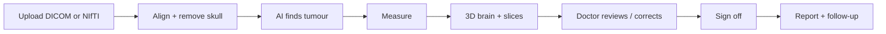

# MedTwin User Manual

This guide shows how to start MedTwin, analyse a brain MRI, review and correct the result, sign
it off, and follow a patient over time. For the project background and accuracy figures, see
[README.md](README.md).

> **AI decision support for qualified clinicians.** Measurements must be verified on the source
> images by a radiologist. MedTwin is not yet validated or approved for clinical decisions.

---

## Contents

1. [What MedTwin does](#1-what-medtwin-does)
2. [What you need](#2-what-you-need)
3. [Start and stop the app](#3-start-and-stop-the-app)
4. [The screen at a glance](#4-the-screen-at-a-glance)
5. [Analyse a scan](#5-analyse-a-scan)
6. [Use the 3D viewer](#6-use-the-3d-viewer)
7. [Use the slice viewer](#7-use-the-slice-viewer)
8. [Correct the outline](#8-correct-the-outline)
9. [Read the findings](#9-read-the-findings)
10. [Review and sign off](#10-review-and-sign-off)
11. [Follow a patient over time](#11-follow-a-patient-over-time)
12. [Report and downloads](#12-report-and-downloads)
13. [Manage cases and privacy](#13-manage-cases-and-privacy)
14. [Personalise the brain template](#14-personalise-the-brain-template)
15. [Troubleshooting](#15-troubleshooting)
16. [Glossary](#16-glossary)

---

## 1. What MedTwin does

You give MedTwin one brain MRI study, straight from the scanner (DICOM) or as NIfTI files.
MedTwin then:

- aligns the four sequences to each other and removes the skull, if needed;
- finds the tumour and splits it into three regions, each with its own colour;
- measures each region in cm³ and as a share of the brain, plus RANO diameters;
- says where it is: hemisphere, front or back, top or bottom;
- builds a realistic 3D brain in the patient's own shape with the tumour inside;
- shows where the AI is unsure.

The doctor then:

- corrects the outline with a brush where needed, and every number updates;
- approves or rejects the result with a signature, all logged in an audit trail;
- compares the scan with earlier scans of the same patient (growth, RANO category).



Today MedTwin recognises **glioma** (a type of brain tumour). Other diseases are planned.

---

## 2. What you need

### Computer

| Item | Requirement |
| --- | --- |
| System | Windows 10 or 11 |
| Python | 3.11 with PyTorch (already set up on this machine) |
| Graphics card | Optional. An NVIDIA GPU makes the tumour model faster; CPU works |
| Browser | Chrome, Edge or Firefox with WebGL (any recent version) |
| Internet | Needed once per page load for the 3D library (Three.js from a CDN) |
| Skull stripping | HD-BET, installed in the app's environment (weights in `C:\Users\admin\hd-bet_params`) |

### Scan

MedTwin needs **four MRI sequences** of one patient from one session:

| Sequence | Also called |
| --- | --- |
| T1 | T1 native, T1n, T1w, T1 SE, MPRAGE (without contrast) |
| T1 contrast | T1c, T1ce, T1 Gd, T1 post, T1 + C |
| T2 | T2w, T2 TSE / FSE |
| FLAIR | T2-FLAIR, T2f, dark fluid |

You can provide them in three ways:

- **DICOM (recommended for real cases):** zip the study folder from a CD or PACS export. MedTwin
  finds the series, suggests which is which, and lets you confirm.
- **NIfTI:** four `.nii` or `.nii.gz` files, or a zip of them. Names must contain `t1`,
  `t1c`/`t1ce`, `t2`, `flair` (or BraTS style `t1n`, `t1c`, `t2w`, `t2f`).
- **Demo:** 188 BraTS test patients already on this computer.

The sequences do **not** need to be aligned or skull-stripped: MedTwin does both. Best results come
from a 3D T1 contrast scan (about 1 mm). Thick slices (over 3 mm) give a warning.

---

## 3. Start and stop the app

### For doctors on the hospital network (normal use)

1. Connect the MedTwin computer to the hospital network.
2. In `Med_Twin\medtwin_app`, double-click **`start_network.bat`**. The window shows the
   addresses to use, for example `https://10.20.30.40:8443`.
3. **First time only:** IT or an administrator allows the port in Windows Firewall, in an
   Administrator Command Prompt:

   ```bat
   netsh advfirewall firewall add rule name="MedTwin" dir=in action=allow protocol=TCP localport=8443 profile=domain,private
   ```

4. Doctors open the address in Chrome or Edge. The connection is encrypted with a certificate made
   by MedTwin itself, so the browser warns once: choose **Advanced**, then **Continue**. For no
   warning, ask IT for a hospital certificate and save it as `certs\medtwin.crt` and `certs\medtwin.key`.
5. Wait about 20 seconds after starting. The top bar shows **Ready · CUDA · Glioma · HD-BET**.

The certificate is renewed automatically when the computer's network address changes.

Instead of double-clicking `start_network.bat`, you can type the same in Command Prompt:

```bat
cd /d C:\Users\admin\Desktop\Med_Twin\Med_Twin\medtwin_app
```

```bat
.venv\Scripts\python scripts\network_setup.py
```

```bat
.venv\Scripts\python -m uvicorn server.app:app --host 0.0.0.0 --port 8443 --ssl-keyfile certs\medtwin.key --ssl-certfile certs\medtwin.crt
```

Common start-up errors and fixes are listed in [README.md](README.md#quick-start-run-medtwin-from-command-prompt).

### On this computer only

Double-click **`start.bat`** and open **http://127.0.0.1:8000**, or in Command Prompt:

```bat
cd /d C:\Users\admin\Desktop\Med_Twin\Med_Twin\medtwin_app
```

```bat
.venv\Scripts\python -m uvicorn server.app:app --host 127.0.0.1 --port 8000
```

### Stop

Click the server window and press **Ctrl + C**. Finished cases and accounts stay saved; doctors
must sign in again after a restart. After updating MedTwin, stop and start the server again.

### Sign in and accounts

**First time:** on the MedTwin computer itself, open `https://127.0.0.1:8443` (or
`http://127.0.0.1:8000`). A **First-time setup** screen asks for the administrator's username, full
name and password. This screen only appears once, and only on that computer.

**Every doctor has their own account.** Corrections, approvals and the audit trail show who did what.

| Role | Can do |
| --- | --- |
| **Administrator** | Everything a radiologist can, plus manage accounts, delete cases, see the security log |
| **Radiologist** | Upload and analyse, correct outlines, approve, reject, reopen |
| **Clinician** | Upload and analyse, view all results, reports and follow-up (read-only review) |

**Add a doctor (administrator):** click **Users** in the top bar, fill in username, full name, role
and a temporary password, click **Add**, and give the doctor the temporary password in person. At
first sign-in they must choose their own.

| Rule | Detail |
| --- | --- |
| Passwords | At least 10 characters, letters and numbers, not containing the username |
| Wrong passwords | 5 in a row lock that username for 5 minutes (also wrong recovery codes) |
| Idle sign-out | After 12 hours without activity, and when the server restarts |
| Forgotten password | See **Forgot your password?** below |
| Doctor leaves | **Deactivate** the account (signs them out at once); accounts are never deleted, so audit trails stay readable |
| Change own password | **Password** in the top bar |
| Security log | **Users → Security log**: sign-ins, failed sign-ins, password resets, recovery codes, account changes, deleted cases |
| Account file | Accounts live in `medtwin_app\data\users.json` with an automatic backup `users.json.bak`. **Never edit these files by hand**; use the screens or the reset command below |

### Forgot your password?

MedTwin does not need email. There are three ways back in.

**1. With your recovery code (you do it yourself, any time)**

Create the code in advance: after your first sign-in MedTwin offers it, or later via **Password →
Create a recovery code**. Enter your current password; a code like `K7QX2-9MDR4-…` appears **once**.
Write it down or keep it somewhere safe, not next to your username. A new code replaces the old one.

When you forget your password:

1. On the sign-in screen click **Forgot password?**
2. Enter your username, keep **I have my recovery code**, type the code (upper or lower case,
   dashes optional) and your new password twice.
3. Click **Set new password**, then sign in with the new password.

The code works once. Create a new one after signing in.

**2. Ask an administrator**

1. On the sign-in screen click **Forgot password?**, enter your username, choose **Ask an
   administrator** and click **Send request**. (The answer is the same whether or not the username
   exists, so the form cannot be used to find accounts.)
2. Administrators see a number on the **Users** button and a **Password reset requested** list.
   The administrator checks who you are (in person or by phone) and clicks **Reset now**.
3. MedTwin shows a generated temporary password (for example `kq7m-r2xh-9tfd`) **once** to the
   administrator, who gives it to you. You choose your own password at the next sign-in.

Administrators can also use **Reset password** next to any account without a request.

**3. The administrator forgot their own password (server computer)**

On the MedTwin computer, in Command Prompt:

```bat
cd /d C:\Users\admin\Desktop\Med_Twin\Med_Twin\medtwin_app
```

List the accounts (shows the exact usernames):

```bat
.venv\Scripts\python scripts\reset_password.py --list
```

Reset one, for example `admin` (prints a temporary password once):

```bat
.venv\Scripts\python scripts\reset_password.py admin
```

Add `--activate` to also re-activate a deactivated account. Sign in with the temporary password and
choose a new one. If the account was locked by wrong passwords, wait 5 minutes or restart the server.

**Tip:** if sign-in keeps failing, check the username first: `reset_password.py --list` shows it.

**4. Start over (nobody remembers any username or password)**

On the MedTwin computer, in Command Prompt, in the `medtwin_app` folder:

```bat
.venv\Scripts\python scripts\reset_password.py --reset-all
```

Type `RESET` to confirm. Every account is moved to `data\account_archive\users-<date-time>.json`
(kept, not destroyed) and everyone is signed out. Cases, reports and the security log stay. Then
open `https://127.0.0.1:8443` on that computer, create the new administrator on the
**First-time setup** screen, and add the doctors again under **Users**. Old cases still show the
names of the doctors who signed them.

---

## 4. The screen at a glance

```
┌──────────────────────────────────────────────────────────────────────────────────┐
│ MedTwin      ● Ready · CUDA · Glioma · HD-BET   Dr A · Radiologist [Password][Log out]│
│ AI decision support for qualified clinicians. Not yet validated or approved…     │
├────────────────┬────────────────────────────────────────┬────────────────────────┤
│ NEW ANALYSIS   │  3D VIEWER                             │ CLINICAL REVIEW        │
│ Patient code   │  [View] [Brain] [Cut] [Shape]          │ Signing as Dr A        │
│ Scan date, age │                                        │ [Approve] [Reject]     │
│ DICOM|NIfTI|Demo│         realistic 3D brain            │ Audit trail            │
│ series list    │         with coloured tumour           ├────────────────────────┤
│ [Analyse]      │              [Expert][Rotate][Snapshot]│ FOLLOW-UP              │
├────────────────┼────────────────────────────────────────┤ chart + RANO table     │
│ PROGRESS       │  SLICES  [Sequence][Overlay][Correct]  ├────────────────────────┤
│ ● ● ● ○ ○      │  (brush bar when correcting)           │ FINDINGS               │
├────────────────┤  axial | coronal | sagittal            │ volumes, diameters,    │
│ RECENT CASES   │                                        │ lesions, downloads     │
└────────────────┴────────────────────────────────────────┴────────────────────────┘
```

| Area | Purpose |
| --- | --- |
| Top bar | Status (ready, GPU or CPU, diseases, skull stripping); your name and role; **Users** (administrators), **Password**, **Log out** |
| Yellow strip | Decision-support reminder |
| Left | Patient details, start an analysis, progress, earlier cases |
| Centre top | Interactive 3D brain |
| Centre bottom | 2D slices, overlays and the correction brush |
| Right | Clinical review and sign-off, follow-up timeline, findings |

---

## 5. Analyse a scan

### 5.1 Patient details (all upload types)

At the top of **New analysis**:

| Field | Use |
| --- | --- |
| **Patient code** | Pseudonymous code, e.g. `GL-0012`. Scans with the same code form a follow-up timeline. Letters, digits, `-` and `_` only. **Never a name or hospital ID.** |
| **Scan date** | Date of the MRI. Filled automatically from DICOM; needed to order follow-ups |
| **Age**, **Sex** | Optional; choose the brain template (section 14) |
| **Case label** | Short description, e.g. "Pre-op MRI" |

### 5.2 DICOM study (recommended)

1. Click the **DICOM** tab.
2. Drop the **zip of the study** on the dashed box, or click it to choose the file.
3. Wait while MedTwin reads the series (about 30 seconds for a typical study). The DICOM files are
   converted and then deleted; names, IDs and birth dates are never stored.
4. Check the list: each series shows a thumbnail, its description, slice count and voxel size,
   and the suggested sequence. Change any wrong choice with its drop-down. Series such as
   diffusion, perfusion and localisers are left as "not used".
5. When all four sequences are chosen, click **Analyse study**.

### 5.3 NIfTI files

1. Click the **NIfTI** tab.
2. Drop the four files (or one zip) on the dashed box. Each row shows the matched file.
3. Fix a wrong row with **Choose**, then click **Analyse scan**.

### 5.4 Demo case

Click **Demo**, pick a patient and click **Run demo case**. Demo cases include expert labels so you
can judge the AI.

### 5.5 Progress

| Step | What happens | Typical time (MX550 laptop) |
| --- | --- | --- |
| Checking the scan | Four readable 3D sequences | under 1 s |
| Aligning sequences, removing the skull | Rigid co-registration to the T1 contrast at 1 mm; HD-BET skull stripping | 0 s if already done; about 5 min with skull stripping on CPU |
| Preparing the images | Orientation, spacing, normalisation | 2–4 s |
| Finding disease regions | AI segmentation + confidence | 5–15 s |
| Building the 3D brain | Realistic and exact brain surfaces | 20–30 s |
| Measuring volumes and diameters | Volumes, location, lesions, RANO | under 7 s |
| Building lesion meshes | 3D surfaces per region | under 6 s |
| Writing the report | Report and slice images | under 1 s |

---

## 6. Use the 3D viewer

### Mouse and touch

| Action | Mouse | Touch |
| --- | --- | --- |
| Rotate | Left-drag | One-finger drag |
| Zoom | Scroll wheel | Pinch |
| Move (pan) | Right-drag | Two-finger drag |
| Region details | Hover | Tap |
| Jump the slices to a region | Click | Tap |

### Toolbar

| Control | What it does |
| --- | --- |
| **View** | Front, Left, Right, Top, Back. The hint at the bottom left says which side is which |
| **Brain** slider | Transparency: low shows the tumour inside, high shows the surface |
| **Cut** | Slice the brain open left–right, front–back or top–bottom; the tumour stays whole |
| **Shape** | **Realistic (fitted):** standard folded brain warped to this patient. **Exact (from scan):** the patient's true outline |
| **Expert labels** | Expert outline as wireframes (demo cases) |
| **Rotate**, **Snapshot** | Spin the brain; save the view as PNG |

Colours: crimson = enhancing tumour, dark red = necrotic core, see-through yellow = edema, pink
with darker grooves = brain. Untick a region under **Findings** to hide it.

In the **Front** view the patient's **left is on your right**.

---

## 7. Use the slice viewer

| Image | Direction | Edge letters |
| --- | --- | --- |
| Axial | Seen from below | A top, P bottom, R left, L right |
| Coronal | Seen from the front | S top, I bottom, R left, L right |
| Sagittal | Seen from the patient's left side | S top, I bottom, A left, P right |

Radiological convention: the patient's right is on the image's left.

| Control | What it does |
| --- | --- |
| **Sequence** | FLAIR, T1, T1 contrast or T2 |
| **Overlay: Current outline** | The outline in use, including any corrections |
| **Overlay: Original AI outline** | What the AI produced before corrections |
| **Overlay: Model confidence** | Magenta where the model is unsure (below about 90% certainty); white line = current outline. Review magenta areas carefully |
| **Overlay: Expert labels** | Expert outline (demo cases) |
| Slider under each image | Move through the slices |
| Click an image | Move the crosshair; the other images follow |

---

## 8. Correct the outline

1. Sign in as a radiologist or administrator (clinicians see results read-only).
2. Click **Correct outline** above the slices. A brush bar appears and the images get a dashed border.
3. Choose what to paint: **Enhancing tumour**, **Necrotic core**, **Edema**, or **Erase**.
4. Set the **Brush** size in mm.
5. Paint on any of the three images. Strokes apply to the slice shown; move the slider to work on
   other slices. Painting never goes outside the brain.
6. **Undo** removes the last stroke; **Discard** removes all unsaved strokes.
7. Click **Save corrections**. Within a few seconds the volumes, diameters, 3D meshes and report
   are recalculated. The findings show the AI's original volume next to the corrected one.
8. **Back to AI outline** removes all corrections (logged in the audit trail).

Saving a correction always sets the case back to **Pending review**, even if it was approved.

If a colleague changed the same case while you were painting, MedTwin does not overwrite their
work: it says who changed it, loads their version and keeps your unsaved strokes, so you can check
and save again.

---

## 9. Read the findings

### Summary tiles

| Tile | Meaning |
| --- | --- |
| cm³ abnormal tissue | Total of all regions |
| % of brain volume | Share of the brain |
| cm³ brain volume | Brain area in the scan (including fluid spaces) |
| separate lesions | Disconnected tumour pieces larger than 0.03 cm³ |

### Regions

Each region shows colour, volume, share of brain, location and **model confidence** (the model's
average certainty inside that region). After corrections it also shows the AI's original volume.

Location compares the region's centre with the brain's centre: left / right hemisphere (more than
5 mm off the midline), "near the midline" otherwise; anterior / posterior = front / back; superior /
inferior = top / bottom.

### Diameters (RANO method)

For each enhancing lesion, on the axial slice where it is largest: the **longest diameter** and the
longest diameter **perpendicular** to it. A lesion is *measurable* if both are at least 10 mm. Up
to three of the largest measurable lesions are *targets*; their products are added up to the
**SPD** (sum of products of perpendicular diameters). Click a row to jump the axial slice there.

### Separate lesions, expert comparison

The lesion table lists each disconnected piece, its size and location. Demo cases also show
**Result vs expert labels** with a Dice score (0.9–1.0 excellent, 0.8–0.9 good, 0.7–0.8 fair,
below 0.7 poor).

### Warnings

Yellow boxes flag thick slices, a model that is unsure about much of the lesion, a brain volume
outside the usual range after skull stripping, or an implausibly large outline (over 40% of the
brain), which usually means the scan was not prepared correctly. **Do not use a result with such a
warning without checking it on the slices.**

"Not detected by this model" never means the brain is healthy: MedTwin only looks for glioma.

---

## 10. Review and sign off

The panel shows **Signing as** your name and role, taken from your sign-in.

| Button | Effect |
| --- | --- |
| **Approve & sign** | Signs the current version with your account name, role and time. The report shows "Reviewed and approved by …" |
| **Reject** | Marks the result unusable; a reason is required. The report says "Do not use these results" |
| **Reopen** | Clears an approval or rejection so the case can be reviewed again |

Rules:

- Only radiologists and administrators can correct, approve, reject or reopen.
- Approve only after any unsaved strokes are saved or discarded.
- Any later correction automatically clears the approval.
- **Audit trail** (under the buttons) lists the upload, AI analysis, every correction (with voxels
  changed), approval, rejection and reopening, with the doctor's account and the time. Entries
  cannot be edited.

---

## 11. Follow a patient over time

1. Give every scan of the same patient the **same patient code** and the correct **scan date**.
2. Open any of those scans. The **Follow-up** card lists all scans, oldest first, with:
   - a chart of **enhancing tumour** (solid crimson line, circles) and **edema** (dashed amber
     line, squares) in cm³; hover a date for exact values;
   - a table with enhancing volume, SPD, change since the previous scan and an **assessment**.
3. Click a row to open that scan.

| Assessment | Rule (enhancing tumour) |
| --- | --- |
| Baseline | First scan |
| Complete response (radiographic) | No enhancing tumour left |
| Partial response (radiographic) | Volume down at least 65%, or SPD down at least 50%, versus baseline |
| Progression (radiographic) | Volume up at least 40%, or SPD up at least 25%, versus the smallest earlier scan, or new measurable disease |
| Stable disease (radiographic) | None of the above |

These are radiographic measurements only. Full RANO also needs non-enhancing disease, new lesions,
steroid dose, clinical status and confirmation scans. **The treating team decides.**

---

## 12. Report and downloads

At the bottom of **Findings**:

| Button | What you get |
| --- | --- |
| **Open report (PDF)** | Patient code, scan date, review status and signature, findings with confidence, RANO diameters, lesions, expert comparison (demo), slice images, preparation steps. Click **Print / Save as PDF** |
| **Realistic brain STL**, **Exact brain STL** | The 3D brain surfaces |
| **Enhancing tumour STL**, **Necrotic core STL**, **Edema STL** | Each region (current outline) |

STL files are in millimetres and share one coordinate frame, so they line up in Blender, MeshLab
or a 3D-printing slicer.

---

## 13. Manage cases and privacy

| Task | How |
| --- | --- |
| Reopen a case | Click it in **Recent cases**, or in the follow-up table |
| Share a case on this computer | Copy the page address (ends with `#job=…`) |
| Delete a case | Administrators only: **✕** in Recent cases, or **Delete this case's data** under Findings (recorded in the security log) |
| Where data is stored | `medtwin_app\data\jobs\<case id>\` (scans, results, audit trail) |
| Unused DICOM uploads | Studies never analysed are deleted once they are 24 hours old (checked at each new DICOM upload) |

Privacy:

- DICOM patient names, IDs and birth dates are never read or stored; DICOM files are deleted after
  conversion. Only series descriptions, timing values and the study date are kept.
- Use pseudonymous patient codes and case labels, never names or hospital numbers.
- Delete cases when they are no longer needed.
- Every doctor signs in; nothing (scans, slices, meshes, reports) is reachable without an account.
- On the network, MedTwin uses HTTPS, so passwords and images are encrypted in transit.
- Keep the MedTwin computer itself locked and its disk encrypted (BitLocker): the case files are
  stored on it.

---

## 14. Personalise the brain template

The realistic brain starts from the FreeSurfer **fsaverage** cortex and is warped to the patient's
scan. To use your own standard brain, save an STL, OBJ, PLY or GLB (millimetres, x right, y front,
z top) in `medtwin_app\assets\templates\` as `brain_<child|adult|older>_<female|male>.stl`,
`brain_<agegroup>.stl`, `brain_<female|male>.stl` or `brain.stl`. Age groups: child under 18,
adult 18–64, older 65 and over. Age and sex pick the file; the shape always follows the scan.

---

## 15. Troubleshooting

| Problem | What to do |
| --- | --- |
| Top bar says **Server offline** | Start the server; wait 20 s; refresh |
| Other computers cannot open MedTwin | Use the address shown in the server window; check both are on the hospital network; add the firewall rule (section 3) |
| Browser warns "Your connection is not private" | Expected with MedTwin's own certificate: **Advanced → Continue**; or install a hospital certificate |
| "Not set up yet" screen | Create the administrator on the MedTwin computer itself |
| "Too many wrong attempts" | Wait 5 minutes, or ask an administrator to reset the password |
| "Wrong username or password" but the password is right | Check the username: `scripts\reset_password.py --list` on the server shows all usernames |
| Forgot password | **Forgot password?** on the sign-in screen: recovery code, or ask an administrator (section 3) |
| Only administrator forgot the password | `scripts\reset_password.py <username>` on the server computer (section 3) |
| Nobody remembers any username or password | `scripts\reset_password.py --reset-all`, then First-time setup (section 3) |
| "The account file … is damaged" | Restore `data\users.json` from a copy; MedTwin repairs it automatically from `users.json.bak` when possible |
| "Change your password first" | Choose your own password in the form shown |
| No **Correct outline** or **Approve** buttons | Your account is a clinician account; ask an administrator to change the role |
| "This case was changed by … while you were working" | A colleague saved first; check their version, your strokes are kept, save again |
| New features missing | Stop the server (Ctrl + C) and start it again |
| "No usable MR series found" | The zip has no MR series with 20+ slices; check you exported the whole study |
| A series is suggested wrongly | Change it in the drop-down before **Analyse study** |
| "Missing sequence(s)" | All four (T1, T1 contrast, T2, FLAIR) are needed |
| Aligning/removing the skull takes minutes | Normal on CPU (about 5 min); HD-BET uses the GPU only with 4 GB or more |
| "HD-BET is not installed" | Install it: `.venv\Scripts\python -m pip install hd-bet` |
| Warning: implausible outline size | Check the slices; usually the skull is still present or sequences are swapped |
| Warning: model is unsure | Switch the overlay to **Model confidence** and review magenta areas |
| 3D area empty, slices work | No internet for Three.js, or WebGL disabled |
| Very slow tumour step | Running on CPU; check the top bar shows CUDA |
| Old look after an update | Press Ctrl + F5 |

---

## 16. Glossary

| Term | Meaning |
| --- | --- |
| DICOM | Standard file format scanners and PACS use for medical images |
| NIfTI | 3D medical image file (`.nii`, `.nii.gz`) used in research |
| Co-registration | Aligning the sequences voxel for voxel |
| Skull stripping | Removing skull and scalp so only the brain remains (HD-BET does this) |
| T1 / T1 contrast | Anatomy image; with contrast dye, active tumour lights up |
| T2 / FLAIR | Show fluid and swelling; FLAIR darkens normal fluid so edema stands out |
| Enhancing tumour | Active tumour that takes up contrast |
| Necrotic core | Dead tissue inside the tumour |
| Edema | Swelling and infiltrated tissue around the tumour |
| Model confidence | How certain the AI is about each voxel's label |
| RANO | Response Assessment in Neuro-Oncology, the standard for judging glioma response |
| SPD | Sum of products of perpendicular diameters of target lesions (mm²) |
| Dice score | Overlap between two outlines, 0 (none) to 1 (perfect) |
| Audit trail | Permanent list of who did what to a case, and when |
| HTTPS | Encrypted web connection, so passwords and images cannot be read on the network |
| Role | What an account may do: administrator, radiologist or clinician |
| Recovery code | One-time code you keep safe, to set a new password yourself if you forget it |
| Temporary password | Password an administrator gives you after a reset; you must change it at sign-in |
| fsaverage | FreeSurfer's standard average brain surface |
| STL | 3D file format for printing and CAD |
